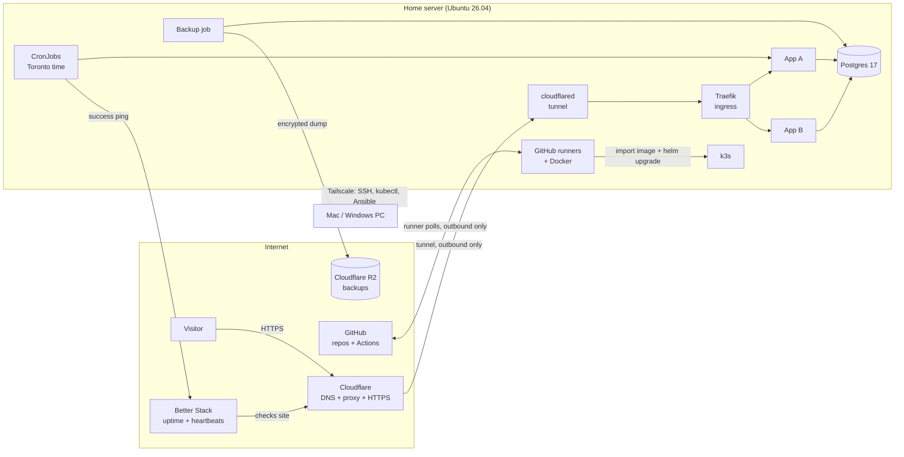

# System Design

One home server runs every app on a single-node Kubernetes cluster (k3s). Apps are tested locally first, then deployed by git tag. Visitors reach apps through Cloudflare; the server has no open inbound ports.

## Overview

## Components

| Component | What it does |
| --- | --- |
| Home server | Asus Chromebox 3 (CN65): i7-8550U (4 cores / 8 threads), 16 GB RAM, SATA SSD, MrChromebox UEFI firmware; Ubuntu Server 26.04 LTS |
| k3s | Single-node Kubernetes; secrets encrypted at rest |
| Traefik | Ingress built into k3s; routes each subdomain to its app; reachable only inside the cluster |
| cloudflared | Outbound tunnel from the server to Cloudflare; replaces open ports and on-server certificates |
| Cloudflare | DNS for the domain, proxy, HTTPS for visitors, R2 object storage for backups |
| Postgres 17 | One shared instance; one database and one user per app |
| GitHub Actions runners | One self-hosted runner service per app repo; a shared lock allows one build at a time |
| Docker | Builds app images on the server; images are imported into k3s (no registry) |
| Shared Helm chart | One chart in this repo deploys every app, with per-app settings |
| SOPS + age | Secrets encrypted in this repo; decrypted only at deploy time |
| Tailscale | Private network for admin access from the Mac, Windows PC and phone |
| Better Stack | External uptime checks and scheduled-job heartbeats; alerts by email |
| Alerts Google Group | One address every tool sends alerts to; members managed in the group |

## Request flow

1. A visitor opens `https://<app>.<domain>`.
2. Cloudflare serves HTTPS and forwards the request through the tunnel.
3. cloudflared, running in the cluster, hands it to Traefik.
4. Traefik routes it by host name to the app's service in its namespace.

The home router has no port forwarding. The home IP address is never exposed.

## Admin access

- SSH, `kubectl` and Ansible connect only over Tailscale.
- Tailscale accepts all traffic arriving over the tailnet before ufw evaluates it, so devices on the tailnet can reach any port the server listens on. Only the owner's devices are on the tailnet; Tailscale access rules (ACLs) are where to restrict it further.
- SSH uses keys only; root and password logins are disabled.
- The Kubernetes API is reachable only over Tailscale (port 6443 on the Tailscale interface).
- k3s's built-in load balancer is off and Traefik has no host ports, so no cluster service listens on the server's network.

## Deploy flow

1. Develop and test locally (see the local setup guide).
2. Push a branch. The pre-push hook runs the fast tests and gitleaks.
3. Open a pull request. The runner runs the full test suite. Review happens before merge.
4. Merge to `main`.
5. Push a release tag in `1.2.3` format.
6. The runner:
    1. Waits for the build lock.
    2. Builds the image with Docker.
    3. Imports it into k3s.
    4. Runs `helm upgrade` with the shared chart and the app's settings.
    5. Removes all but the last 3 images of that app.
    6. Sends a deploy heartbeat.
7. Rollback: redeploy one of the 3 kept tags.

Runners act only on trusted events: tag pushes and branches from the owner. Pull requests from forks need approval.

## Environments

| Environment | Where | Purpose |
| --- | --- | --- |
| Local | Mac, Windows (WSL 2) or Linux, with Docker Compose | Every change is run and tested here before it's pushed |
| Local, prod-like (optional) | k3d cluster on the same machine | Check the Helm chart before a release |
| Prod | Home server | The only shared environment; no pre-prod |

## Scheduled jobs

- Kubernetes CronJobs with `timeZone: America/Toronto`, so daylight saving time is handled.
- `concurrencyPolicy: Forbid`, so runs never overlap.
- Each job pings its Better Stack heartbeat on success. A missed ping sends an alert.

## Data and backups

- Postgres 17 runs as a plain deployment on local storage.
- Every night a job dumps each database, encrypts it with age and uploads it to R2.
- Retention: 7 daily and 4 weekly copies.
- A restore test runs before go-live, then monthly as an automated job that alerts on failure.

## Secrets

- Stored encrypted in this repo with SOPS and age.
- The runner decrypts them at deploy time and applies them as Kubernetes Secrets.
- The age private key is kept on the server, in Bitwarden and in one offline copy.
- Google OAuth: the first token is stored in SOPS; renewed tokens are saved encrypted in the app's database.

## Security baseline

- No inbound ports from the internet: the home router forwards no ports, and ufw denies all incoming traffic from the home network and the internet. Its rules for SSH and the Kubernetes API on the Tailscale interface still apply if Tailscale's own firewall rules are turned off.
- Automatic security updates every day; when an update requires a reboot, it happens Sunday at 4am Toronto time.
- fail2ban on SSH.
- One namespace per app, with CPU and memory limits.
- gitleaks before each commit and push, and in CI.
- Runners can use Docker, which gives root-level access to the server, so any workflow a runner executes effectively runs as root. Runners therefore act only on trusted events (see "Deploy flow").
- No personal data in any repo, config, log or commit.

## Logs

- Only recent container logs are kept, through Kubernetes' built-in log handling (`kubectl logs`).
- Longer log retention is planned for later.

## Monitoring and alerts

| Check | Source | Alert |
| --- | --- | --- |
| Site up | Better Stack polls each public URL | Email to the alerts group |
| Scheduled job ran | Job pings its heartbeat | Missed ping → email |
| Backup ran | Backup job pings its heartbeat | Missed ping → email |
| Deploy succeeded | Runner pings its heartbeat | Failure → email |

## Failure and recovery

| Failure | Effect | Recovery |
| --- | --- | --- |
| Home power or internet outage | All apps down | The server powers back on by itself when power returns (checked by the unplug test in server setup); the tunnel reconnects by itself |
| Bad deploy | One app broken | Redeploy a previous tag |
| Disk or hardware failure | Server lost | Replace hardware, run the server setup guide, restore from R2 |
| Lost age key | Secrets and backups unreadable | Restore the key from Bitwarden or the offline copy |

## Repo layout

| Repo | Contains |
| --- | --- |
| `homeserver-infra` (private) | Ansible playbooks, the shared Helm chart, platform manifests (Postgres, cloudflared, backups), encrypted secrets, these docs |
| Each app repo | App code, tests, `Dockerfile`, `compose.yaml` for local runs, deploy settings for the shared chart, CI workflow |

## Out of scope

Pre-prod, an image registry, high availability, multiple servers.
