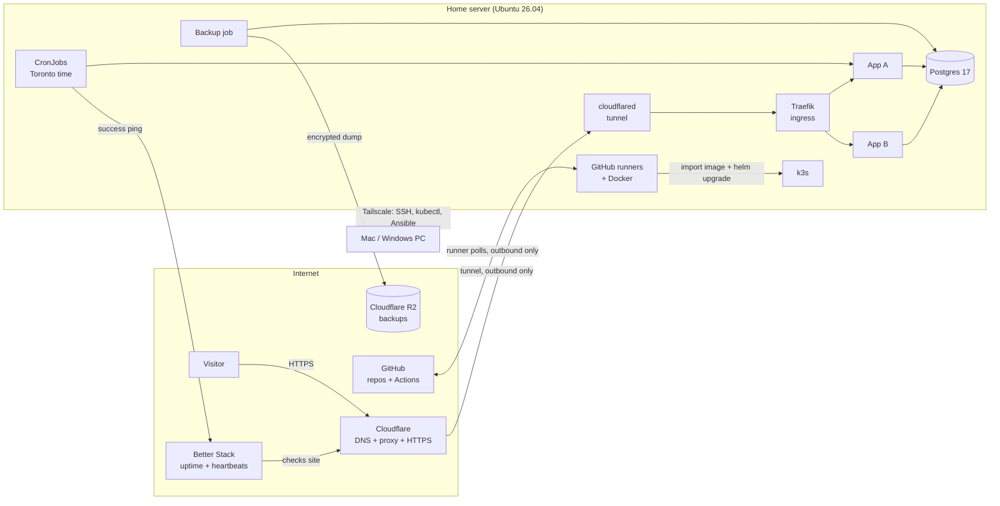

# System Design

One home server runs every app on a single-node Kubernetes cluster (k3s). Apps are tested locally first, then deployed by git tag. Visitors reach apps through Cloudflare; the server has no open inbound ports.

## Overview

## Components

| Component | What it does |
| --- | --- |
| Home server | Asus Chromebox 3 (CN65): i7-8550U (4 cores / 8 threads), 16 GB RAM, SATA SSD, MrChromebox UEFI firmware; Ubuntu Server 26.04 LTS |
| k3s | Single-node Kubernetes; secrets encrypted at rest |
| Traefik | Ingress built into k3s; routes each subdomain to its app; reachable only inside the cluster |
| cloudflared | Outbound tunnel from the server to Cloudflare; replaces open ports and on-server certificates |
| Cloudflare | DNS for the domain, proxy, HTTPS for visitors, R2 object storage for backups |
| Postgres 17 | One shared instance; one database and one user per app |
| GitHub Actions runners | One self-hosted runner per app repo for tag deploys; a shared lock allows one build at a time. Pull request tests run on GitHub-hosted runners. |
| Docker | Builds app images on the server; images are imported into k3s (no registry) |
| Shared Helm chart | One chart in this repo deploys every app, with per-app settings |
| SOPS + age | Secrets encrypted in this repo; decrypted only at deploy time |
| Tailscale | Private network for admin access from the Mac, Windows PC and phone |
| Better Stack | External uptime checks and scheduled-job heartbeats; alerts by email |
| Alerts Google Group | Address for tools that can send to any address; Better Stack's free plan alerts only the account owner, so its alerts go there directly |

## Request flow

1. A visitor opens `https://<app>.<domain>`.
2. Cloudflare serves HTTPS and forwards the request through the tunnel.
3. cloudflared, running in the cluster, hands it to Traefik.
4. Traefik routes it by host name to the app's service in its namespace.

The home router has no port forwarding. The home IP address is never exposed.

## Admin access

- SSH, `kubectl` and Ansible connect only over Tailscale.
- Tailscale accepts all traffic arriving over the tailnet before ufw evaluates it, so devices on the tailnet can reach any port the server listens on. Only the owner's devices are on the tailnet; Tailscale access rules (ACLs) are where to restrict it further.
- SSH uses keys only; root and password logins are disabled.
- The Kubernetes API is reachable only over Tailscale (port 6443 on the Tailscale interface).
- k3s's built-in load balancer is off and Traefik has no host ports, so no cluster service listens on the server's network.

## Deploy flow

1. Develop and test locally (see the local setup guide).
2. Push a branch. The pre-push hook runs the fast tests and gitleaks.
3. Open a pull request. GitHub-hosted runners run the full test suite. Review happens before merge.
4. Merge to `main`.
5. Push a release tag in `1.2.3` format.
6. The app's self-hosted runner calls `homeserver-deploy`, which:
    1. Waits for the build lock.
    2. Builds the image with Docker.
    3. Imports it into k3s through a root helper that accepts only images named after the app.
    4. Runs `helm upgrade` with the shared chart, the app's `deploy/values.yaml`, and the image and domain set on the server; a failed upgrade is rolled back.
    5. Removes all but the last 3 images of that app.
    6. Pings the deploy heartbeat if one is set (`<url>/fail` if any step failed). Without one, a failed deploy is reported by GitHub's failed-workflow email.
7. Rollback: redeploy one of the 3 kept tags.

Self-hosted runners act only on trusted events: release tags pushed by the owner. Pull request tests, including from forks, run only on GitHub-hosted runners, and fork pull requests need approval.

## Environments

| Environment | Where | Purpose |
| --- | --- | --- |
| Local | Mac, Windows (WSL 2) or Linux, with Docker Compose | Every change is run and tested here before it's pushed |
| Local, prod-like (optional) | k3d cluster on the same machine | Check the Helm chart before a release |
| Prod | Home server | The only shared environment; no pre-prod |

## Scheduled jobs

- Kubernetes CronJobs with `timeZone: America/Toronto`, so daylight saving time is handled.
- `concurrencyPolicy: Forbid`, so runs never overlap.
- Each job pings its Better Stack heartbeat on success and `<url>/fail` on failure. A failure alerts at once; a missed ping alerts when its period and grace run out.

## Data and backups

- Postgres 17 runs as a single StatefulSet on the server's disk (k3s local storage). Each app has its own database and user.
- A `canary` database holds 100 known rows, so backups and restore checks always have real data to verify.
- Every night at 03:00 a job dumps the roles and each database, encrypting each dump with the age public key as it is written (no plaintext on disk), and uploads it to R2 under `daily/<date>/`; on Sundays also under `weekly/<date>/`.
- Retention: daily copies are kept 7 days and weekly copies 28 days (about 4).
- On the 1st and 15th of each month at 05:00, a restore check downloads the newest backup, decrypts it with the server's age key, checks every dump is readable and restores `canary` into a scratch database, expecting 100 rows. It fails loudly on any problem.
- A restore test runs before go-live. A rebuild restores everything with `restore.yml`.

## Secrets

- Stored encrypted in this repo with SOPS and age.
- Ansible decrypts them on the admin machine and applies each app's secrets as the Kubernetes Secret `<app>-env`, which the app reads as environment variables. A changed Secret restarts the app. The runner never holds the age key.
- The age private key is kept on the admin machine, in Bitwarden, in one offline copy, and on the server (`/etc/homeserver/age/keys.txt`, root only) for restoring and testing backups.
- Google OAuth: the first token is stored in SOPS; renewed tokens are saved encrypted in the app's database.

## Security baseline

- No inbound ports from the internet: the home router forwards no ports, and ufw denies all incoming traffic from the home network and the internet. Its rules for SSH and the Kubernetes API on the Tailscale interface still apply if Tailscale's own firewall rules are turned off.
- Automatic security updates every day; when an update requires a reboot, it happens Sunday at 4am Toronto time.
- fail2ban on SSH.
- One namespace per app, with CPU and memory limits.
- gitleaks before each commit and push, and in CI.
- Runners can use Docker, which gives root-level access to the server, so any workflow a runner executes effectively runs as root. Runners therefore act only on trusted events (see "Deploy flow").
- No personal data in any repo, config, log or commit.

## Logs

- Only recent container logs are kept, through Kubernetes' built-in log handling (`kubectl logs`).
- Longer log retention is planned for later.

## Monitoring and alerts

| Check | Source | Alert |
| --- | --- | --- |
| Site up | Better Stack polls each public URL | Email to the Better Stack account owner |
| Scheduled job ran | Job pings its heartbeat (`/fail` on failure) | Failure or missed ping → email |
| Backup ran | Backup job pings its heartbeat (`/fail` on failure) | Failure or missed ping → email |
| Restore check passed | Twice-monthly restore check pings its heartbeat (`/fail` on failure) | Failure or missed ping → email |
| Deploy succeeded | The app's deploy workflow run (a failed deploy fails the run; Helm rolls back) | GitHub emails the person who pushed the tag |

## Failure and recovery

| Failure | Effect | Recovery |
| --- | --- | --- |
| Home power or internet outage | All apps down | The server powers back on by itself when power returns (checked by the unplug test in server setup); the tunnel reconnects by itself |
| Bad deploy | One app broken | Redeploy a previous tag |
| Disk or hardware failure | Server lost | Replace hardware, run the server setup guide, restore from R2 |
| Lost age key | Secrets and backups unreadable | Restore the key from Bitwarden or the offline copy |

## Repo layout

| Repo | Contains |
| --- | --- |
| `homeserver-infra` (private) | Ansible playbooks, the shared Helm chart, platform manifests (Postgres, cloudflared, backups), encrypted secrets, these docs |
| Each app repo | App code, tests, `Dockerfile`, `compose.yaml` for local runs, `deploy/values.yaml` for the shared chart, a test workflow (GitHub-hosted) and a deploy workflow (self-hosted, on release tags) |

## Out of scope

Pre-prod, an image registry, high availability, multiple servers.
